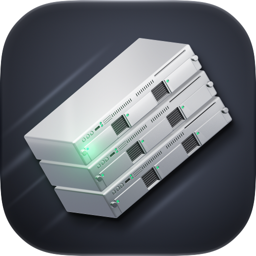

# PortBar app icon



A rack of three 1U servers modelled on the front plate of Apple's Xserve (G4 slot-load / G5): brushed
aluminium, studio-lit, set on a rising diagonal over a slate background with faint data streaks and one
glowing status LED. It is a real 3D render, split into layers and assembled into an
[Icon Composer](https://developer.apple.com/icon-composer/) document.

*Xserve and Apple are trademarks of Apple Inc. PortBar is not affiliated with or endorsed by Apple. The Apple
logo that sits on the real front plate is deliberately left out.*

The source of truth the app builds from is [`../Resources/AppIcon.icon`](../Resources/AppIcon.icon).
Everything in this folder exists to regenerate and edit it.

```
renderer/render.swift     the 3D renderer (a small signed-distance-field ray marcher, no dependencies)
renderer/build_icon.py    assembles the rendered layers into an Icon Composer .icon
renderer/make.sh          one command that does all of it
```

Generated, and git-ignored: `layers/`, `layers-split/`, `preview/`, `PortBar.icon`, `PortBar-split.icon`.

## What is modelled

All positioned from photographs of the real front plate:

- rack-ear **thumbscrews** at both ends of every plate
- a **control strip** along the top: three round buttons with diagonal slits, a port, two LEDs, a block of
  fine perforations, two rows of vent slots with a gap between them, and a long **optical-drive slot**
- raised **drive carriers** below it, each with a green LED, separated by recessed **vent windows** with louvres
- **brushed aluminium**: fine horizontal grain, soft studio reflections, a diagonal light gradient across the lids

## Regenerating

```sh
cd Icon/renderer
./make.sh                                 # about 20 s: renders every layer and both .icon documents
cp -R ../PortBar.icon ../../Resources/AppIcon.icon     # use the result in the app
```

It needs Xcode 26 or later (for `swiftc` and Icon Composer's `ictool`). Tweak the look with environment
variables, for example `KEY=1.8 GRAIN=0.2 ./make.sh`.

| Variable | Default | What it does |
|---|---|---|
| `UNITH` | 1.3 | unit height multiplier (1.0 is a true 1U; features keep their size) |
| `KEY`, `FILL`, `AMB` | 2.1, 0.25, 0.40 | key, fill and ambient light |
| `FALL` | 0.22 | light falloff across the stack |
| `EXPO` | 0.85 | exposure |
| `REFL`, `DIFFUSE` | 1.5, 0.45 | metal reflection and matte body colour |
| `GRAIN` | 0.10 | brushed-grain strength |
| `SPEC`, `SHEEN`, `LIDGRAD` | 1.8, 2.4, 0.55 | edge highlights, lid sheen, diagonal lid gradient |
| `BOUNCE`, `LEDSCALE` | 0.8, 1.2 | green light thrown by the hero LED, and its glow size |
| `OUTLINE` | 0.7 | cool contour where surfaces turn away |
| `BACKLIGHT`, `BLR`, `BLX`, `BLY` | 0.34, 380, -60, -70 | pool of light behind the stack: strength, size, offset |
| `VIGNETTE` | 0.40 | edge and corner darkening |
| `BG_TOP`, `BG_BOT` | `0.19,0.20,0.235`, `0.03,0.03,0.04` | background gradient colours (r,g,b), read by `build_icon.py` |

The camera is the optional arguments of `render` (yaw, pitch, roll, view size); the defaults are
-26, 22, -30 and 1.68. The geometry (unit size, spacing, where each feature sits) is at the top of
`render.swift`.

## Editing by hand in Icon Composer

Open `Icon/PortBar.icon` (or `PortBar-split.icon`, with one group per server unit for more depth). The layers
are 1024 x 1024 transparent PNGs on the same canvas, so they line up with no repositioning:

| Group (frontmost first) | Layers (frontmost first) | Blend |
|---|---|---|
| 1 | `glow.png`, `object.png` | `glow` is Screen. Glass **off**: the lighting is baked in |
| 2 | `shadow.png` | Normal |
| 3 | `streaks.png` | Screen |
| 4 | `backlight.png`, `vignette.png` | `backlight` is Screen |

The document fill is a diagonal gradient from `#30333C` to `#08080A`, with its own deeper fills for the dark
and tinted icon styles.
