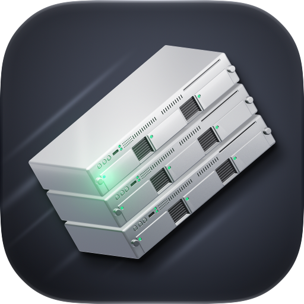

<p align="center">
  
</p>

<h1 align="center">PortBar</h1>

<p align="center">
  <b>See every local dev server at a glance, from your menu bar.</b><br>
  Open it, stop it, force-quit it. No more <code>lsof | grep</code>.
</p>

<p align="center">
  
  
  
</p>

PortBar is a small, native macOS menu bar app that lists the servers listening on a machine and the project each
one belongs to. A server holding `localhost:3000` can be stopped without opening a terminal.

## Features

- Shows the number of running dev servers in the menu bar.
- Detects common runtimes such as Node, Python, Ruby, Java, PHP, Deno, Bun, Go, Postgres, Redis, MongoDB, Docker
  and Vite. The list is editable in Settings, and every listening port can be shown.
- Labels each row with the name from the nearest `package.json`, or the folder name if there isn't one.
- Opens `http://localhost:<port>` in the browser with one click.
- Stops a server with `SIGTERM` and shows "Stopping…" until the process is gone.
- Reveals **Stop** when a row is swiped with two fingers on the trackpad.
- Offers **Force Quit** (`SIGKILL`) when a process ignores `SIGTERM`.
- Can send a notification when a server starts or stops, and groups several changes into one summary.
- Launches at login, with one toggle in Settings.
- Is built with SwiftUI, has no Dock icon, and follows light and dark appearance.
- Runs `lsof` and sends signals. It has no network access and no analytics.

## Install

Requires macOS 13 Ventura or later on Apple silicon.

Download the latest `PortBar-<version>.dmg` from the **Releases** page, open it and drag **PortBar.app** onto the
**Applications** shortcut, then open it from Applications. PortBar isn't notarized by Apple, so macOS blocks it on
first launch:

- macOS 15 Sequoia and later: open **System Settings > Privacy & Security** and click **Open Anyway**.
- macOS 13 and 14: right-click the app, choose **Open**, then click **Open**.

### Build from source

Building requires Xcode 26 or later on Apple silicon.

```sh
git clone <this repository>
cd portbar
./build.sh
```

This builds `build/PortBar.app`. Move it to the **Applications** folder and open it. A server-rack icon with a
count appears in the menu bar.

If macOS refuses to open the app, right-click it and choose **Open**, or run
`xattr -dr com.apple.quarantine /path/to/PortBar.app`.

To start PortBar at login, turn on **Launch at login** in Settings.

## Usage

Click the menu bar icon to open the panel. Each row shows the port, the project name, and the process and PID.

- Compass icon: open the server in the browser.
- Stop icon, or a two-finger right-to-left swipe: stop the server.
- Red icon, then **Force Quit**, or a swipe: force-quit a server that won't stop.
- **Show all listening ports**: list every port, not only dev servers.
- Circular-arrow icon: refresh now. The panel also refreshes every 5 seconds.
- Gear icon: open Settings.
- Power icon: quit PortBar.

## Permissions and privacy

- PortBar is not sandboxed, because it uses `/usr/sbin/lsof` and sends signals with `kill`, and the App Sandbox
  blocks both.
- To label rows it reads the `package.json` near each server's working directory. If servers run from
  `~/Documents`, `~/Desktop` or `~/Downloads`, macOS may ask once for access.
- Notifications are optional, and permission is requested only when they are turned on.
- PortBar contains no networking code, so nothing leaves the machine.
